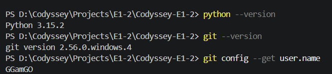
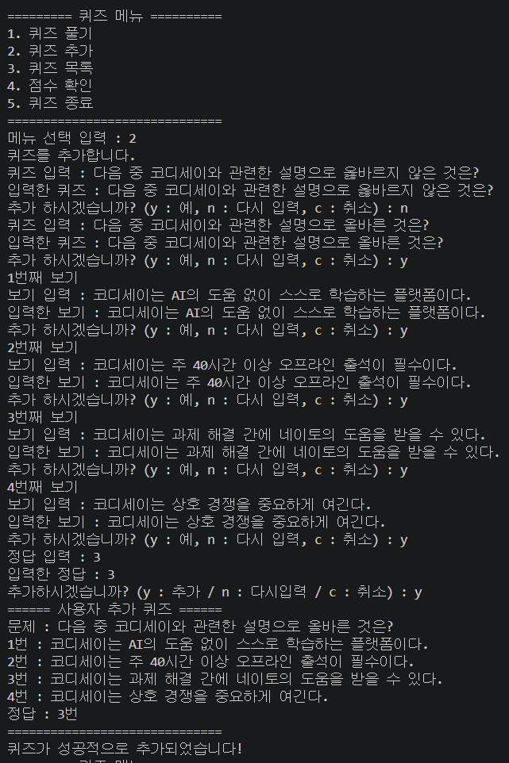
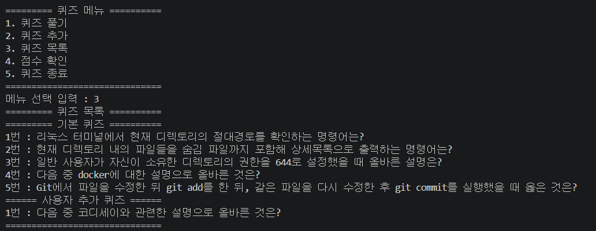
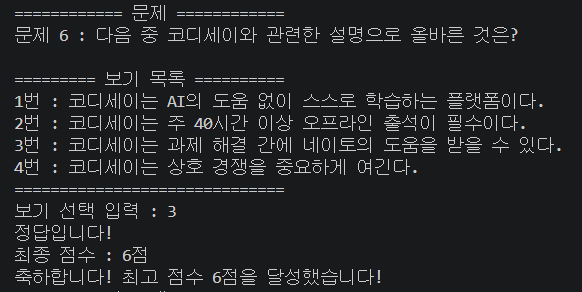
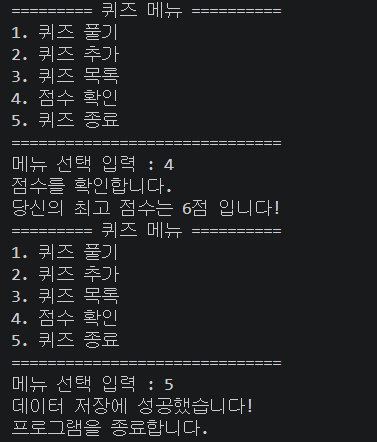
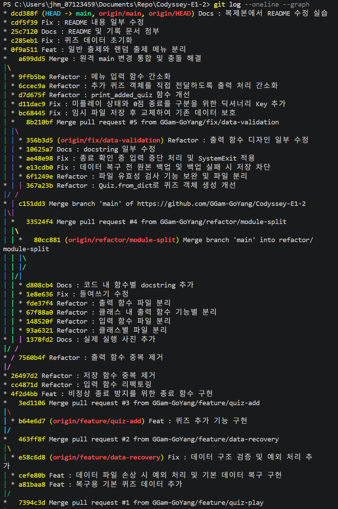
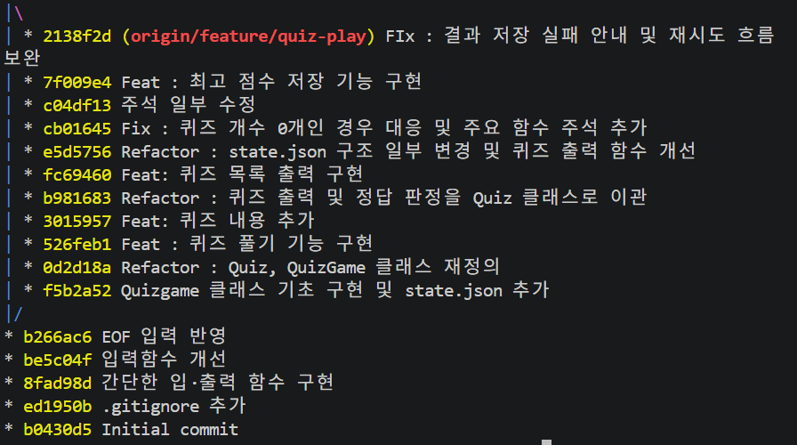
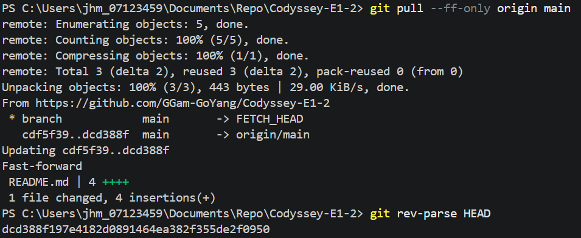

# Codyssey E1-2 | 개발 도구 복습 퀴즈

Linux·Docker·Git을 복습하는 Python 콘솔 퀴즈 게임입니다. 문제 풀이, 사용자 문제 추가, 목록 조회, 최고 점수 확인을 제공하며, 퀴즈와 점수는 JSON 파일에 저장합니다.

[GitHub 저장소](https://github.com/GGam-GoYang/Codyssey-E1-2)

## 목차

1. [프로젝트 개요와 주제](#1-프로젝트-개요와-주제)
2. [개발 환경과 실행 방법](#2-개발-환경과-실행-방법)
3. [주요 기능](#3-주요-기능)
4. [파일 구조](#4-파일-구조)
5. [데이터 저장과 복구](#5-데이터-저장과-복구)
6. [클래스와 모듈 설계](#6-클래스와-모듈-설계)
7. [실행 화면](#7-실행-화면)
8. [Git 작업 이력](#8-git-작업-이력)
9. [Git 저장소 복제 실습](#9-git-저장소-복제-실습)
10. [보너스 과제](#보너스-과제)

## 1. 프로젝트 개요와 주제

학습한 명령어를 단순히 암기하는 데서 그치지 않고, 실행 결과와 사용 조건을 판단하는 문제로 복습하기 위해 Linux·Docker·Git을 주제로 구성했습니다.

기본 문제는 `quiz_recovery.py`의 `DEFAULT_QUIZZES`에 **5개**가 있으며, 각 문제는 보기 4개와 정답 번호를 가집니다.

| 번호 | 학습 내용 |
|---|---|
| 1 | 현재 디렉터리의 절대 경로 확인 |
| 2 | 숨김 파일을 포함한 상세 목록 출력 |
| 3 | 디렉터리 권한과 파일 접근 가능 여부 |
| 4 | Docker 컨테이너의 실행·종료와 읽기 전용 볼륨 |
| 5 | Git 스테이징 이후 수정한 파일의 커밋 내용 |

## 2. 개발 환경과 실행 방법

- 운영체제·편집기: Windows, VSCode
- 개발 환경: Python 3.15.2, Git 2.56.0.windows.4
- 실행 조건: Python 3.10 이상
- 외부 패키지 설치 없이 Python 표준 라이브러리 사용



```powershell
git clone https://github.com/GGam-GoYang/Codyssey-E1-2.git
cd Codyssey-E1-2
python main.py
```

이미 저장소가 있다면 VSCode에서 프로젝트 폴더를 열고 `python main.py`를 실행합니다. 
데이터 경로가 상대 경로이므로 **`main.py`가 있는 폴더에서 실행**합니다.

진입점은 `main.py`의 `QuizGame().run()`이며, 데이터를 읽은 뒤 메뉴를 반복 출력합니다.

## 3. 주요 기능

```text
========= 퀴즈 메뉴 ==========
1. 퀴즈 풀기
2. 퀴즈 풀기(랜덤)
3. 퀴즈 추가
4. 퀴즈 목록
5. 점수 확인
6. 퀴즈 종료
==============================
```

| 메뉴 | 동작 |
|---|---|
| 퀴즈 풀기 | 저장된 순서대로 모든 문제를 출제하고 정답·오답을 판정합니다. |
| 퀴즈 풀기(랜덤) | 전체 문제를 중복 추출 없이 무작위 순서로 출제합니다. |
| 퀴즈 추가 | 문제, 보기 4개, 정답 번호를 확인받아 추가하고 저장합니다. |
| 퀴즈 목록 | 기본 문제와 사용자 추가 문제를 구분하여 보여줍니다. |
| 점수 확인 | 미플레이 상태를 안내하거나 최고 점수를 표시합니다. |
| 퀴즈 종료 | 저장을 시도한 뒤 종료합니다. 저장 실패 시 종료 여부를 다시 묻습니다. |

### 점수와 완료 여부

- 정답 하나당 1점이며, 모든 문제를 마치면 최종 점수를 출력합니다.
- 기존 최고 점수를 넘었을 때만 `high_score`를 갱신합니다.
- 끝까지 풀었다면 0점이어도 `has_played`를 `True`로 저장합니다. 처음 플레이하다 중단한 경우와 구분합니다.
- 문제가 없으면 안내 후 메뉴로 돌아갑니다.

### 입력 검증

| 입력 상황 | 처리 |
|---|---|
| 빈 값·공백만 입력 | 안내 후 재입력 |
| 숫자 입력에 문자·소수 입력 | 정수 변환 실패 안내 후 재입력 |
| 메뉴 1\~6, 정답 1\~4 범위 밖 | 허용 범위 안내 후 재입력 |
| 숫자 앞뒤 공백 | 공백 제거 후 검사 |
| 추가 확인 `y / n / c` | 등록 / 다시 입력 / 취소 |
| 메뉴·플레이 중 Ctrl+C 또는 EOF | 종료 처리로 이동하여 저장 시도 |

## 4. 파일 구조

```text
Codyssey-E1-2/
├── main.py                 # 프로그램 진입점
├── quiz.py                 # Quiz: 문제 데이터·출력·정답 판정
├── quiz_game.py            # QuizGame: 메뉴·플레이·상태·파일 입출력
├── input_utils.py          # 문자·정수·확인 입력 처리
├── output_utils.py         # 메뉴·목록·추가 문제 출력
├── validators.py           # 저장 데이터 구조 검사
├── quiz_recovery.py        # 기본 퀴즈 5개
├── state.json              # 퀴즈·최고 점수·플레이 완료 여부
├── Evidence/
│   ├── Quiz/               # 퀴즈 실행 화면 8장
│   ├── Git/                # 커밋 그래프 2장·Pull 결과 1장
│   └── dev_environment.png # 개발환경 확인
├── docs/
│   ├── DESIGN.md           # 설계·예외 처리·복구
│   ├── EXECUTION.md        # 실행 화면과 출력 기록
│   └── GIT_HISTORY.md      # 커밋·브랜치 병합 이력
└── README.md
```

## 5. 데이터 저장과 복구

### 데이터 형식

프로젝트 루트의 `state.json`을 UTF-8로 읽고 씁니다.

| 필드 | 자료형 | 의미 |
|---|---|---|
| `quizzes` | 배열 | 문제 목록 |
| `question` | 문자열 | 문제 내용 |
| `choices` | 문자열 배열 | 보기 4개 |
| `answer` | 정수 | 정답 번호 1~4 |
| `source` | 문자열 | 기본 문제 `default`, 사용자 문제 `user` |
| `high_score` | 정수 | 0 이상의 최고 점수 |
| `has_played` | 불리언 | 한 번이라도 게임을 완료했는지 |

`question`, `choices`, `answer`, `source`는 `quizzes` 배열의 각 문제에 들어갑니다. JSON은 사람이 읽기 쉽고 목록·키-값 구조를 표현할 수 있으며, 표준 `json` 모듈만으로 저장과 복원이 가능합니다.

### 로드·저장 순서

```text
시작 → load_json → validate_state → Quiz.from_dict → 메뉴
문제 추가 / 게임 완료 / 종료 → convert_json → 임시 파일 쓰기·닫기 → 원본 교체
```

저장은 `state.json.tmp`에 먼저 완료한 뒤 `os.replace()`로 원본을 교체합니다. 임시 파일 쓰기에 실패하면 기존 `state.json`은 유지됩니다.

| 오류 상황 | 처리 |
|---|---|
| 파일 없음 | 기본 문제·0점·미플레이 상태 생성 후 저장 시도 |
| JSON 문법·인코딩·구조 오류 | 원본 백업을 시도한 뒤 기본 데이터로 복구 |
| 파일 읽기 오류 | 오류 안내, 백업 시도 후 기본 데이터로 진행 |
| 백업 실패 | `save_blocked`로 이번 실행의 저장 차단 |
| 저장·교체 실패 | 오류 안내, 종료 시 계속 종료할지 확인 |

백업 파일은 `state-backup-날짜시간.json` 형식으로 생성합니다. 상세 복구 절차는 [설계 문서](docs/DESIGN.md)에 정리했습니다.

## 6. 클래스와 모듈 설계

| 구성 | 책임 |
|---|---|
| `Quiz` | 문제 하나의 데이터와 출력·정답 판정을 묶습니다. |
| `QuizGame` | 문제 목록·최고 점수·완료 여부를 관리하고 게임을 진행합니다. |
| `input_utils` | 재입력과 확인 과정을 처리합니다. |
| `validators` | 파일에서 읽은 자료형·필드·범위를 검사합니다. |
| `output_utils` | 공통 화면 출력을 담당합니다. |

문제 단위 기능과 게임 전체 상태를 분리해 변경 범위를 줄였습니다. `Quiz.from_dict()`는 저장 데이터에서 객체를 만드는 규칙을 한곳에 모으고, `save_json()`과 `save_notice()`는 저장 처리와 안내를 구분합니다.

[설계 상세: 입력 검증·종료 처리·복구 절차](docs/DESIGN.md)

## 7. 실행 화면

### 문제 추가



### 퀴즈 목록



### 플레이 결과



### 점수 확인과 종료



추가 문제를 포함한 6문제를 완료하고, 최고 점수 6점과 저장 성공 안내를 확인한 화면입니다. 캡처는 랜덤 메뉴 추가 전 화면입니다.

[전체 실행 화면 8장 및 출력 기록](docs/EXECUTION.md)

## 8. Git 작업 이력

메뉴·플레이·추가·저장 기능을 기능별로 커밋하고, 기능 브랜치에서 작업한 내용을 main에 병합했습니다.

### 사용한 Git 명령어

| 명령어 | 기능 |
|---|---|
| `git init` | 현재 폴더를 Git 저장소로 초기화 |
| `git checkout <브랜치명>` | 지정한 브랜치로 전환 |
| `git clone https://github.com/GGam-GoYang/Codyssey-E1-2.git` | 원격 저장소의 파일·이력을 새 로컬 폴더에 복제 |
| `git add <파일명>` | 변경 내용을 스테이징 |
| `git commit -m "메시지"` | 스테이징한 내용을 로컬 커밋으로 기록 |
| `git push` | 로컬 커밋을 원격 저장소에 반영 |
| `git pull` | 원격 변경을 가져와 현재 브랜치에 통합 |
| `git merge <브랜치명>` | 지정한 브랜치를 현재 브랜치에 병합 |

추가로 `git status`로 작업 상태를, `git rev-parse HEAD`로 양쪽 커밋의 일치를 확인했습니다. 
`git log --oneline --graph`로 커밋과 브랜치 병합 이력을 조회했습니다.

### 브랜치별 작업과 병합

| 브랜치 | 주요 작업 | 병합 기록 |
|---|---|---|
| `feature/quiz-play` | 문제 풀이·목록·최고 점수 저장 | [PR #1](https://github.com/GGam-GoYang/Codyssey-E1-2/pull/1) |
| `feature/data-recovery` | 손상 데이터 복구·검증 | [PR #2](https://github.com/GGam-GoYang/Codyssey-E1-2/pull/2) |
| `feature/quiz-add` | 사용자 퀴즈 추가 | [PR #3](https://github.com/GGam-GoYang/Codyssey-E1-2/pull/3) |
| `refactor/module-split` | 클래스·입력·출력 모듈 분리 | [PR #4](https://github.com/GGam-GoYang/Codyssey-E1-2/pull/4) |
| `fix/data-validation` | 데이터 검증·원본 백업·종료 처리 | [PR #5](https://github.com/GGam-GoYang/Codyssey-E1-2/pull/5) |

커밋 메시지는 `Feat`, `Fix`, `Refactor`, `Docs`로 변경 목적을 구분합니다.

```bash
git log --oneline --graph
```



[전체 커밋 그래프와 병합 이력](docs/GIT_HISTORY.md)

## 9. Git 저장소 복제 실습

별도 폴더에 저장소를 clone한 뒤 README를 수정하고 add, commit, push를 실행했습니다.
기존 작업 폴더에서 pull하여 변경 사항을 반영했습니다.

- 반영 방식: Fast-forward
- 실습 완료 당시 양쪽 HEAD: `dcd388f197e4182d0891464ea382f355de2f0950`
- 기존 폴더에서 README 변경 반영 확인



## 보너스 과제
### 랜덤 출제

`random.sample()`로 플레이용 목록을 따로 만들어 원본 목록과 저장 순서를 유지합니다. 일반 출제와 랜덤 출제는 같은 진행 메서드를 사용하며, 랜덤 메뉴는 `lambda`를 통해 선택 시점에 실행합니다.